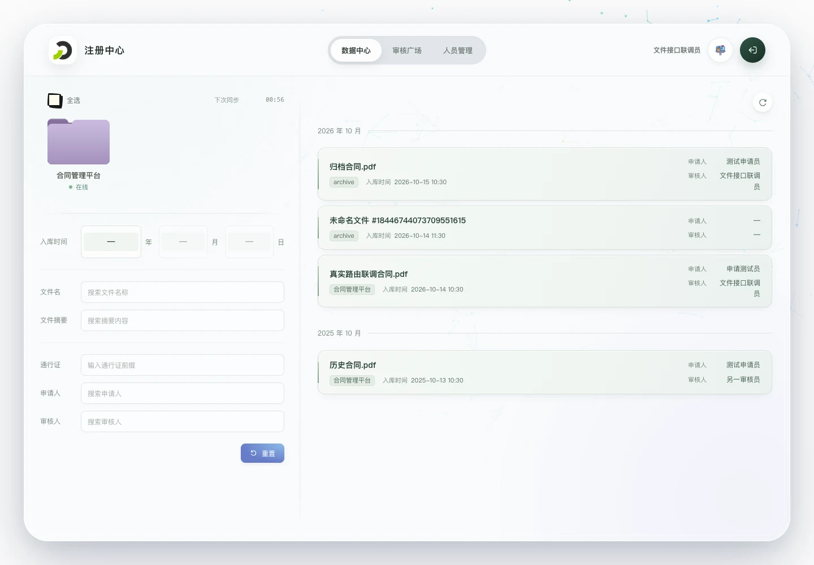
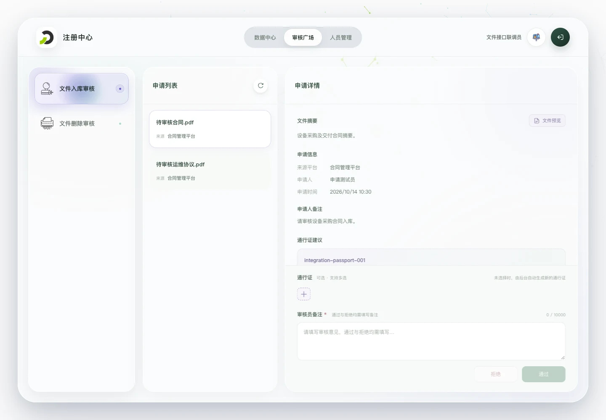
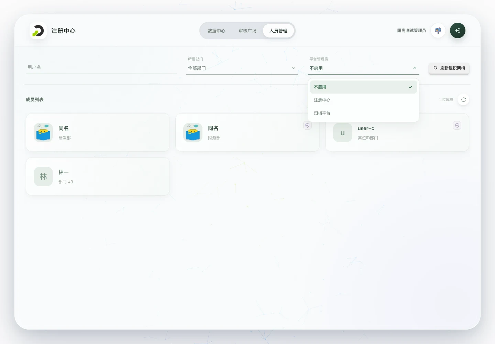

# 知识沉淀注册中心前端

面向知识沉淀注册中心后端的浏览器端界面，使用 Vue 3、Vue Router 4、Vite 和 JavaScript。整体风格参考 `contract-service-fe`，包含动态分子背景、半透明外框及窄屏适配。

## 当前功能

| 功能 | 当前实现 |
| --- | --- |
| 访问与账户 | 直接读取同域 `localStorage.access_token` 调用业务接口，不提供登录页或钉钉免登；账户资料并行读取。首屏准备期间展示五色竖条与分子背景，就绪后淡入工作台。 |
| 数据中心 | 左侧为平台同步、平台选择及条件筛选，右侧为文件列表；文件按入库时间降序、按入库年月分组，右上角可刷新目录。 |
| 文件筛选 | 支持平台、入库日期、通行证前缀、文件名、摘要、申请人和审核人组合过滤。文本输入失焦后生效，提示随输入更新；重置清空全部条件。 |
| 文件预览 | 根据原件类型展示 PDF、音频或视频，内容显示后淡入摘要及通行证悬浮入口；下载资源在页面内临时缓存。 |
| 审核广场 | 入库／删除审核三栏布局，接入正式待审列表、原件预览、必填备注及通过／拒绝提交，包含二次确认、加载反馈与成功退出动画。 |
| 审核记录 | 查看本人入库、关联删除审核历史及全体操作人的文件等级变更记录；切换复用缓存，平台优先显示名称。 |
| 人员管理 | 顶部提供用户名、部门与管理员联合筛选，下方展示头像、用户名和部门；已接入正式人员、部门和平台接口，管理员按 userid 关联；支持多部门展示与筛选，点击成员卡片可编辑平台等级与管理员身份，经二次确认后提交增量更新。 |

入库审核支持 0–100 文件等级滑动条与数值输入，双向同步；通过时提交等级，拒绝时不提交。审核广场另提供“文件等级调整”，支持目录筛选和逐项等级编辑，已接入等级更新接口及未确认结果重试。详情见[审核广场](description/features/review-square.md#文件入库审核)。

平台列表包含全部非自身平台及在线／离线状态，按后端下次同步计划更新。数据中心、入库审核及删除审核使用正式接口。人员管理已接入正式用户、部门及头像接口；项目不提供固定登录密码。三个工作台通过单个路由出口与 KeepAlive 缓存切换，保留各自的筛选、滚动位置和页面内状态；刷新或离开应用后不保留筛选与未提交草稿。

## 页面预览

以下为此前隔离联调保存的桌面截图（1440 × 1000），使用测试身份及文件，不代表生产数据，也不作为最新代码的验收结果。

### 数据中心

左侧集中筛选，右侧文件按入库时间降序、按年月分组。



### 审核广场

审核类型、申请列表、申请详情三栏排列，支持原件预览和审核提交。



### 人员管理

顶部提供用户名、部门及管理员联合筛选，下方展示用户卡片；已接入正式人员、部门及头像接口。



## 本地运行

```bash
npm ci
npm run dev
```

- 本机入口：`http://127.0.0.1:16080/dev/knowledge-accumulation/registry/`
- 开发域名入口：`https://talent.szkl.com/dev/knowledge-accumulation/registry/`
- 构建部署入口：`https://talent.szkl.com/knowledge-accumulation/registry/`
- 默认后端：`http://127.0.0.1:16000`

Vite 允许 `talent.szkl.com` 的 Host 请求，开发映射须完整保留 `/dev/knowledge-accumulation/registry/` 前缀转发至本机 `16080`。需要修改后端地址时，复制 `.env.example` 为 `.env.local`，设置 `REGISTRY_BACKEND_URL`。统一入口需在同源 `localStorage` 的 `access_token` 键保存原始 token，再跳转到注册中心。本项目不需要登录模式、开发 token 或 CorpId 配置；详情见[共享凭据与鉴权](description/platform/authentication.md)。

## 构建、预览与验证

```bash
npm test
npm run build
npm run preview
```

构建输出至 `dist/`。`npm run build` 会先同步 PDF.js 运行时资源；当前未配置 Lint 脚本。预览联调须连接提供生产 API 前缀的后端，配置见[服务与预览](description/platform/deployment.md#vite-服务与预览)。`npm test` 只运行本地 `tests/*.test.js`，不执行浏览器联调脚本。`tests/` 按项目要求排除提交，新检出仓库不包含这些测试脚本；执行前需确认本地文件存在，不能将缺少测试或零用例视为验证通过。

2026-10-30 本地核验：6 项自动测试通过，覆盖人员多部门解析与筛选、权限增量提交及主要失败路径；生产构建、Docker 镜像构建、独立及统一部署 Compose 配置校验通过。临时 Nginx 容器验证了深层页面、静态资源与缓存、PDF.js 资源、模拟 API 路径及 Bearer／401 转发。

专题中的浏览器、真实 FastAPI 路由隔离联调及截图记录来自此前验证，不属于本次自动测试覆盖范围；部分历史测试夹具已不在当前工作区。本次未重跑完整浏览器流程，也未验证线上 HTTPS、FRP 或真实业务后端。

## 路由与部署

| 页面 | 应用内路径 |
| --- | --- |
| 数据中心 | `/data-center` |
| 审核广场 | `/review-square` |
| 人员管理 | `/personnel` |

开发页面前缀为 `/dev/knowledge-accumulation/registry/`，构建预览和容器部署为 `/knowledge-accumulation/registry/`。只区分访问前缀，不配置开发账号或钉钉登录模式。从共享存储读取 token 后直接请求业务接口；缺少凭据、401 或 403 时展示返回知识沉淀入口的按钮，开发返回 `/dev/knowledge-accumulation/`，构建部署返回 `/knowledge-accumulation/`。旧 `/workspace` 及 `/login` 地址进入数据中心。

开发 API 通过同源 `/dev/knowledge-accumulation/registry/api/` 请求，Vite 与网关均保留 `/dev`；构建部署使用 `/knowledge-accumulation/registry/api/` 原样代理。Docker 默认向宿主机 `127.0.0.1:23080` 映射 HTTP 端口，再由外层 HTTPS 网关转发。镜像、后端网络和网关要求见[环境与部署](description/platform/deployment.md)。本仓库配置完成不代表云端已部署。

图片图标输出为带内容哈希的独立资源，Nginx 静态服务及构建预览支持一年缓存，图片内容变化后使用新 URL；Vite 源码服务保留缓存校验与热更新。文件原件的页面内临时缓存与图标 HTTP 缓存相互独立。

## 项目文档

- [项目定位与开发边界](description/project.md)
- [文档导航与运行说明](description/readme.md)
- [注册中心导航与数据中心布局](description/features/workspace.md)
- [文件目录、筛选及月份分组](description/features/catalog.md)
- [平台模型、在线状态及同步计划](description/features/platforms.md)
- [文件展示器与预览缓存](description/features/file-preview.md)
- [审核广场](description/features/review-square.md)
- [审核记录](description/features/review-history.md)
- [人员筛选、多部门与权限更新](description/features/personnel.md)
- [页面路由与错误回退](description/platform/routing.md)
- [共享凭据与后端鉴权](description/platform/authentication.md)
- [环境与部署](description/platform/deployment.md)
- [开发规范](AGENTS.md)

## 历史页面参考

[登录页](description/assets/screenshots/login-desktop.jpg) · [平台概览](description/assets/screenshots/platform-countdown-desktop.jpg) · [手机登录页](description/assets/screenshots/login-mobile.jpg) · [域名开发入口](description/assets/screenshots/development-domain.jpg)。这些截图来自此前隔离联调，账户及数据为测试配置，工作台截图不代表最新布局。
