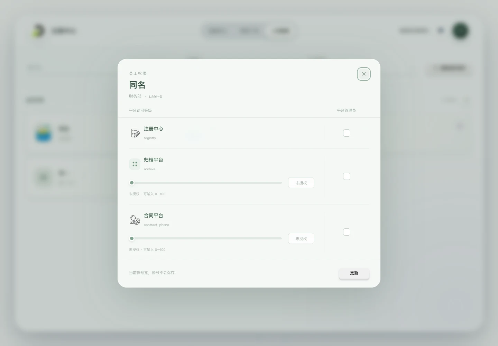

# 人员管理

人员管理接入正式用户、部门与平台接口，提供用户名、部门及管理员联合筛选和用户卡片，不保留临时 mock 数据。提供组织架构同步操作，同时提供员工权限编辑预览，暂不提交权限更新。

[查看窄屏预览](../assets/screenshots/current-personnel-mobile.webp)。截图使用隔离测试身份和虚构用户，头像使用测试图片，不代表真实人员。

## 布局与交互

顶部依次为用户名、部门及平台管理员筛选，右侧提供“刷新组织架构”按钮，复用数据中心重置按钮的立体灰色模板；首次点击向上滚入橙色“确认刷新”，3 秒内再次点击才调用 `POST /user/refresh-all`，420ms 入场期间使用原生 disabled 禁用按钮，拦截连点；超时向下滚回，不提供取消按钮。确认后继续向上滚入“刷新中”，持续使用原生 disabled 禁用按钮，禁用态不产生按压反馈，列表刷新及重试入口同时锁定且处理函数再次校验，切换工作台不取消请求也不重复提交；后端成功后重新读取人员、部门及平台管理员资料，保留有效筛选条件。失败显示后端信息及数据库是否已更新，不自动重试，重新操作仍需二次确认。成员列表的圆形刷新按钮仅执行 GET 查询，不调用组织架构同步。窄屏下按钮换行靠右。下方卡片展示头像、用户名和所属部门，盾牌表示平台管理员。桌面三列、中等窗口两列、窄屏单列，筛选保留淡入淡出及补位过渡。部门及平台管理员使用统一的轻量下拉面板，包含浅绿选中态、勾选标识、滚动区域和展开收起过渡；支持方向键、Home／End、回车确认、Escape 关闭、Tab 离开和点击外部关闭，切换工作台后自动收起。

用户名、部门与管理员条件取交集。输入用户名时，在当前部门及管理员范围内提供候选，失焦或回车后应用姓名／用户 ID 的文本包含匹配；选择候选时按 userid 精确筛选，同名用户不会混淆。只剩一位匹配人员时滚动并高亮该卡片。选择人员不会重置其他条件；条件冲突时显示空结果，“清空筛选”同时清除三个条件。

部门选项按部门 ID 匹配，保留没有员工的部门。管理员下拉首项为“不启用”，后续按完整平台目录展示平台名称（包含注册中心及离线平台）。不启用时不限制管理员身份；选择具体平台后，仅显示该平台的管理员，与用户名、部门条件取交集。平台成功刷新后若已选平台被移除，则恢复“不启用”。首次平台目录失败时，管理员身份保持未知，禁用管理员筛选；已有成功目录时保留最近结果并提示更新失败。人员或部门刷新失败保留上一次完整快照，提供重试入口。人员和部门首次完整加载成功后在当前页面缓存，包括空数组；离开再返回及恢复页面可见时直接复用数据和筛选，不重复请求或显示 loading。首次失败或中断时可重新进入重试；“刷新人员列表”及错误重试主动查询最新完整快照。组织架构刷新成功后使人员缓存失效并重新读取；若此时已离开人员管理，则下次进入读取更新后的数据。页面刷新、组件卸载或共享凭据改变后重新加载，不复用旧身份快照。

## 接口与模型

接口均使用共享用户 Bearer token；查询不附加筛选参数，组织架构刷新不发送参数或请求体。开发路径增加 `/dev`，由 Vite 代理移除。契约见后端[用户与部门 API](../../../registry-be/description/api/user.md)、[平台 API](../../../registry-be/description/api/platform.md)。

| 接口后缀 | 用途 |
| --- | --- |
| `POST /user/refresh-all` | 从钉钉刷新已有员工姓名、部门，增量同步姓名；不会导入全量新员工 |
| `/user/user-list` | 读取 userid、name、department_id、avatar_url、platform_permissions |
| `/user/department-list` | 读取部门 id 与 name |
| `/platform/list` | 读取完整平台目录及 admins，包括 registry 和离线平台 |

完整前缀为 `/knowledge-accumulation/registry/api`。用户接口的 `name` 映射为展示名，空值回退 userid；账户栏仍使用 `/auth/me` 的 `username`。部门找不到时显示“部门 #ID”。部门 ID 和权限整数按十进制字符串保存，避免大整数精度损失。

模型位于 [personnel.js](../../src/models/personnel.js)。按大小写敏感的 userid 关联 `admins[].userid`，不按同名或权限值判断。权限值 0 保留，缺少权限与 0 不等同；管理员身份与平台权限独立。`platformAccess` 合并完整目录及用户权限中的平台，保存名称、在线状态、是否授权、权限值和管理员身份。共享平台目录的 `allPlatforms` 用于人员建模，`platforms` 排除 registry 用于数据中心文件夹。

刷新接口同步等待后端完成，前端时限 330 秒（后端默认 300 秒），部署网关读取超时同步设为 330 秒。请求失败不等于数据库未变更；网络中断或超时会提示结果未确认，不自动重发，支持先通过成员列表 GET 查询核实。

## 员工权限弹窗

点击成员卡片或用键盘激活后，打开该员工的权限弹窗。按平台逐行展示名称、代号及访问等级；平台图标复用知识沉淀统一入口的注册中心和合同平台 WebP，在 `platformAppearance.js` 中按平台代号映射，其他平台保留通用图标。注册中心仅展示平台信息与管理员复选框，不展示或编辑访问等级，也不以其已有等级校验阻止管理员修改；其他平台等级由 0–100 整数滑块和数值输入同步调整，右侧复选框单独编辑该平台管理员身份，保留列标题，不额外重复“管理员”文字；复选框保留包含平台名称的无障碍标签。等级和管理权互不推导；空数值表示未授权，与明确的等级 0 区分。原始异常等级不会静默截断，显示校验提示。

当前按已确认范围仅实现界面预览，尚未接入权限更新接口。“更新”在草稿有有效修改时可点击：首次向上滚入橙色“确认更新”，420ms 入场期间原生禁用，3 秒内再次点击后才展示未提交到后端的预览提示；超时向下返回。修改等级或管理员勾选、切换员工、关闭弹窗均清除确认状态。不会修改人员列表或发送任何权限变更请求。草稿由原始资料复制，关闭后丢弃，再次打开重新读取当前快照。管理员资料未知时禁用相应选择与更新，避免将未知身份当成非管理员。

弹窗沿用浅色圆角表面与模糊遮罩，内容独立滚动，支持关闭按钮、Escape 及点击遮罩关闭，关闭时恢复卡片焦点；切换工作台关闭弹窗。窄屏保持等级控件在左、管理员复选框在右。

## 头像读取与释放

用户的 `avatar_url` 为文件名，前端保存为 `avatarFilename`，仅接受 32 位小写十六进制加 `.webp`，不接受外部 URL 或目录。通过 `GET /knowledge-accumulation/registry/api/resource/avatar/{filename}` 携带共享 Bearer 读取 WebP，开发请求自动增加 `/dev`，不直接请求知识后端。

图片完成解码后淡入，缺少头像、404、服务异常或解码失败时显示姓名首字。401／403 沿用统一鉴权回退。头像请求使用浏览器默认 HTTP 缓存，遵循成功响应的 `Cache-Control: private, max-age=86400` 和 `Vary: Authorization`，缓存时长由后端配置决定（默认一天，设为 0 时不缓存），凭据变化时独立获取；头像更新后文件名变化，新地址立即加载新图片。错误响应为 `no-store`，失败可重试。前端仍合并同一凭据、同一文件的并发请求，不额外建立 localStorage 或页面 Blob 缓存；目录、身份及文件原件请求仍保持原缓存策略。展示使用临时 Blob URL，文件名变化或卡片卸载时释放；迟到结果不会覆盖已卸载的卡片，凭据变更后的旧响应不会显示。

成员列表读取及刷新使用居中转圈；空列表及筛选无匹配淡入 `empty.webp` 和“空空如也”，筛选为空时保留“清空筛选”入口。统一规则见[列表与详情的状态展示](workspace.md#列表与详情的状态展示)。

## 验证

隔离联调复用正式 FastAPI 用户、部门、平台、身份和头像路由，替换数据依赖，不读取真实数据库；覆盖同名用户、registry／离线平台管理员、大整数部门 ID、无员工部门、刷新失败保留、平台失败与重试、空列表、头像鉴权与窄屏布局。头像缓存联调验证同一凭据重复读取不产生新网络请求、新文件名独立加载、不同凭据隔离及 401 不缓存。组织架构刷新通过正式路由的隔离服务验证 GET／POST 分离、首次点击不提交、入场连点拦截、超时回退、等待期间锁定、工作台切换防重发、成功重查及部分失败提示。自动测试覆盖解析、关联、联合筛选、共享 Bearer、头像并发合并、失败重试及凭据变化。
