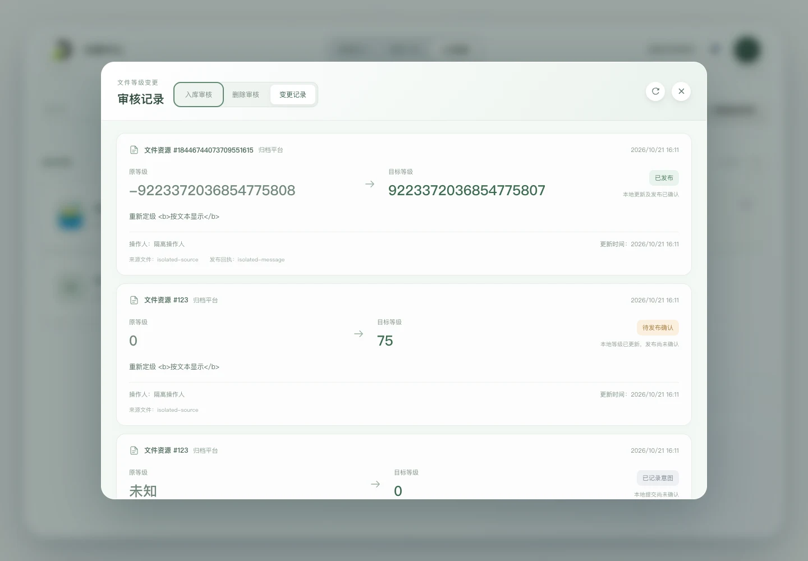

# 我的审核记录

右上角原信箱入口改为“审核记录”，沿用原图标。弹窗参照 `contract-service-fe` 的 `ReviewLogDialog.vue`：浅绿渐变顶部、圆角大弹窗、背景模糊、左侧记录列表及右侧详情；窄屏改为上方列表、下方详情，各自滚动。顶部提供“入库审核／删除审核／变更记录”三个平级选项、当前类型记录刷新和关闭按钮，类型及详情切换采用淡入淡出，尊重减少动画偏好。

## 本人入库审核历史

[`reviewHistoryApi.js`](../../src/services/reviewHistoryApi.js) 调用 `GET /knowledge-accumulation/registry/api/ingestion-review/history`，使用现有 Bearer 人员会话，不传 `reviewer` 查询参数，由后端按当前登录身份查询。页面没有查看其他人员的入口，前端直接展示后端返回的本人记录，不依赖账户资料加载或本地 userid 过滤。具体契约见[后端入库审核历史](../../../registry-be/description/api/ingestion-review.md#按审核员获取入库审核历史)。

[`reviewHistory.js`](../../src/models/reviewHistory.js) 校验公开展示字段、带时区时间、已完成的 `approved`／`rejected` 状态和 SQLite 审核 ID。ID 精确保留为字符串，拒绝重复及无效响应，保留后端倒序，不将申请人当作审核人。

列表显示文件名称、来源平台名称及通过／拒绝状态，不显示申请时间；申请时间保留在详情的申请信息中。默认选中第一条，详情直接从文件摘要开始，不重复展示顶部文件名、平台及审核状态标签；申请信息对齐排列，通行证使用独立浅绿区域并支持长值换行。历史空人员或未知通行证 null 显示“—”，通行证数组逐项展示，空数组显示“无通行证”，摘要为空显示“暂无摘要”。内容按文本展示，不执行 HTML。此入口只读历史，不提交审核决定，不自动请求原件。

[`useReviewHistory()`](../../src/composables/useReviewHistory.js) 在弹窗打开、类型首次访问或可见性恢复时获取历史；同一次打开期间切回已成功加载的类型（包括空数组）直接使用内存缓存，不重新请求或展示 loading，各类型保留选中项；重复进行中的请求合并，关闭、切换删除类型、隐藏或卸载时取消，晚到响应不覆盖新状态。手动刷新可读取最新记录，失败保留上次成功记录并显示错误和重试，成功空数组清空旧记录及详情。401 使用既有会话失效流程。页面内保留最近结果和仍存在的选中记录；重新打开默认回到入库审核，各类型在本次打开首次访问时重新查询；未完成或首次失败的类型切回时可重新读取。共享 token 改变时清除旧身份的缓存并忽略旧响应；页面刷新和退出清空内存状态。

## 本人关联的删除审核历史

“删除审核”调用 `GET /knowledge-accumulation/registry/api/deletion-review/history`，携带 Bearer，不传 `reviewer` 查询参数，由后端按当前登录人员返回关联历史。具体契约见[删除审核历史](../../../registry-be/description/api/deletion-review.md#按审核员获取删除审核历史)。

返回范围包括当前人员作出删除决定的记录，以及当前人员曾批准入库的文件的删除记录。响应中的 `reviewer` 是实际删除审核员，可能不是当前账户；前端不再次按响应审核人过滤，避免丢失原入库审核员关联到的记录。

删除历史直接使用接口保存的文件名称和摘要快照，不依赖已删除的正式目录；历史名称缺失时使用“文件资源 #resource_id”标识，未绑定资源时显示“删除申请 #审核ID”。列表显示平台名称及批准／拒绝删除状态，不显示申请时间；详情从“文件摘要”开始，摘要缺失时显示“暂无摘要”，后续展示申请人、申请时间、删除原因、实际删除审核人、意见、审核时间、资源编号和原通行证。未知字段显示空值提示，不生成名称或摘要，不自动请求原件。资源 ID 支持 unsigned BIGINT 上限，使用 JSON 原始数字文本精确保留。

两个类型各自持有记录、加载／错误状态及选中 ID；类型切换会取消离开的请求，首次访问类型时读取，已成功加载则复用本次打开的缓存，不互相覆盖。两种记录均支持刷新、失败保留与重试及成功空状态，接口错误不会伪装为无记录。此功能只读历史，不提交删除决定。

## 弹窗与验证

[`ReviewHistoryDialog.vue`](../../src/components/ReviewHistoryDialog.vue) 使用原生 dialog 提供模态焦点约束；关闭按钮、Escape 和遮罩外点击可关闭，关闭后焦点返回入口。打开弹窗暂停背景动画，关闭恢复；路由切换、退出或会话失效会收起弹窗。

当前可运行测试及验证限制见根目录 [README](../../README.md#构建预览与验证)。此前使用隔离数据与实际 FastAPI 历史路由验证本人历史、通过／拒绝详情、历史空字段、错误后保留和重试、成功空列表、类型切换、关闭及桌面／390px 窄屏显示。测试不访问生产数据库，不提交真实审核。

[桌面审核记录](../assets/screenshots/review-history-desktop.jpg) · [窄屏审核记录](../assets/screenshots/review-history-mobile.jpg)。截图为隔离测试账户及数据。

所有启动方式均直接读取真实入库及删除审核历史接口；临时预览记录及开发开关已移除。历史预览截图只用于说明样式，不代表当前账户的真实数据。

来源平台复用共享平台目录及公开模型，优先按 `source_platform` 查找平台名称，目录未加载或缺少平台时回退代号；离线平台同样显示名称。平台目录由注册中心布局统一持有，在数据中心、审核广场、人员管理任一可见或审核记录打开时同步，弹窗与结果列表不另行请求重复目录。

刷新按钮沿用参考项目的单箭头圆弧图标和圆形阴影按钮，刷新期间按 0.8 秒／圈旋转，读取完成后转完当前圈再停，期间禁止重复点击。关闭或切换类型时重置动画，减少动画偏好下不旋转。

删除历史已用实际 FastAPI 路由隔离联调，验证原入库审核员关联返回的其他删除审核员记录、BIGINT、未绑定资源、空字段、类型选择保留、失败重试、空历史及桌面／窄屏显示。[查看删除审核记录](../assets/screenshots/deletion-history-desktop.jpg)。

两种历史的 `passport` 均按字符串数组或 null 解析，统一规则及目录筛选见[通行证数组契约](catalog.md#通行证数组契约)。

详情不显示顶部文件名称、来源平台栏或右上角的审核结果标签，直接从文件摘要开始；列表中的审核状态继续保留，入库及删除审核记录均遵循此布局。

入库和删除审核记录详情均展示后端 `file_level` 文件等级，以精确的十进制整数呈现，等级 0 正常显示。入库拒绝或历史未知为 null 时显示“—”，不推测默认等级；删除记录读取申请时保存的等级快照，通过和拒绝均可包含等级，文件已删除也无需重新查询资源或目录。

记录列表和详情在读取及刷新时均显示居中转圈；列表为空淡入 `empty.webp` 和“空空如也”，详情为空淡入 `sleep.webp`。状态与内容依次退出、进入，错误不视为空数据；统一规则见[列表与详情的状态展示](workspace.md#列表与详情的状态展示)。

## 文件等级变更历史

“变更记录”与入库、删除审核平级，读取 `GET /knowledge-accumulation/registry/api/catalog/file-level-history`。携带共享 Bearer，不传查询参数；此接口供 registry 管理员查看全部操作人的日志，不限本人，不按当前人员二次过滤。具体契约见[后端文件等级调整历史](../../../registry-be/description/api/catalog.md#获取文件等级调整历史)。

参照 `contract-service-fe` 的 `FileLevelHistoryList.vue`，此类型使用整宽卡片列表，展示资源编号、来源平台名称、创建时间、原等级 → 目标等级、操作时姓名快照、变更备注、更新时间、来源文件 ID 及已有发布回执。操作人名称为空时回退 userid。接口没有文件名和摘要，因此用资源编号标识，不额外请求目录或原件；文件被删除后也可阅读日志。备注以文本展示。

`prepared` 展示“已记录意图／本地提交尚未确认”，`local_updated` 展示“待发布确认／本地等级已更新，发布尚未确认”，`published` 展示“已发布／本地更新及发布已确认”。目标等级是该次调整的目标，不当作文件当前等级；已发布不表示来源平台已经消费。未知原等级显示“未知”，等级 0 正常显示；等级与 ID 按原始 JSON 整数精确保留，不按当前编辑范围截断历史。保持后端创建时间和日志 ID 倒序的结果顺序。

复用审核历史读取及缓存逻辑，每次打开后首次访问查询，切回缓存类型不重复请求；手动刷新、重新打开后首次访问、页面恢复可见时读取最新记录。刷新失败保留原卡片并提供重试，不触发等级更新或消息发布；成功空数组显示 `empty.webp` 和“空空如也”，加载使用居中转圈。此类型没有独立详情栏，不展示详情空图标。三类记录、加载与错误状态独立。

隔离联调使用实际 FastAPI 路由与替代日志服务，验证全部三种状态、其他操作人、未知及零等级、完整整数精度、平台名、文本备注、类型切换缓存、刷新失败保留与重试、空列表及 390px 窄屏；不读取真实数据库或变更真实文件。

[窄屏变更记录](../assets/screenshots/file-level-history-mobile.webp)。预览使用隔离测试数据。
